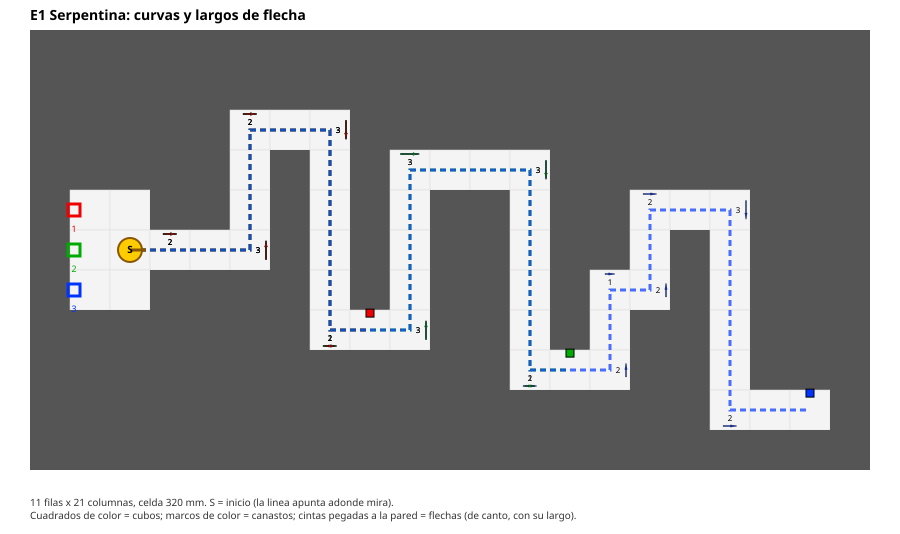
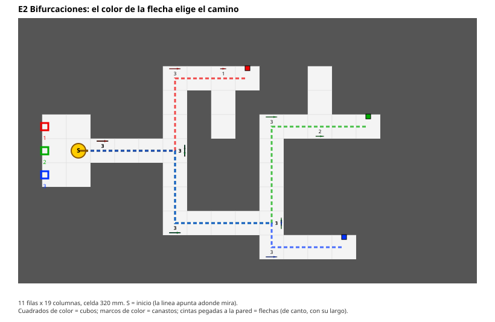
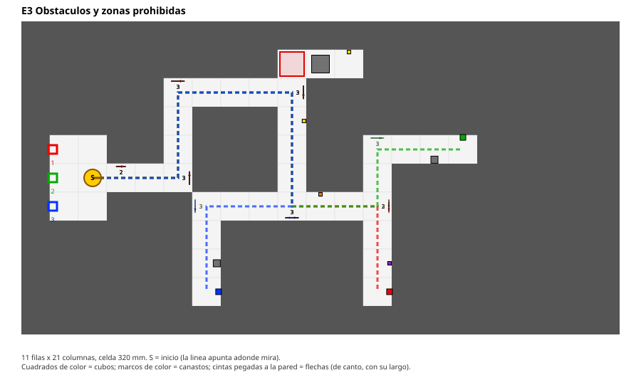
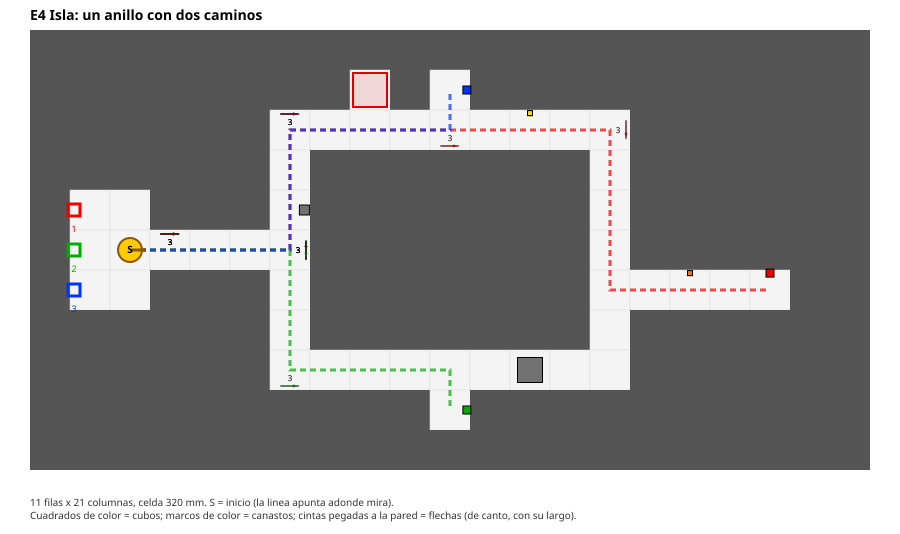
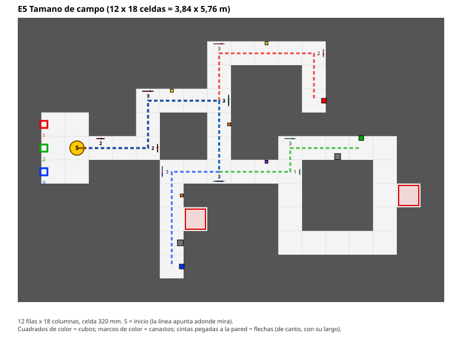
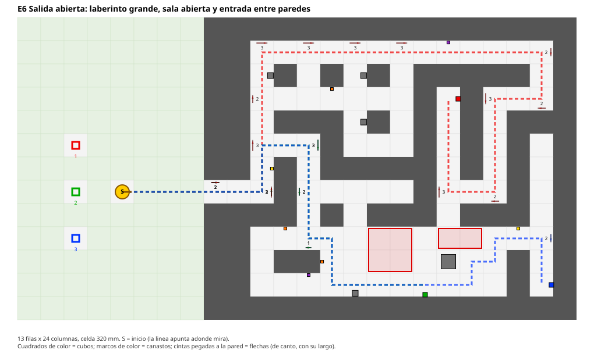

# Escenarios de simulación del laberinto

> Documento de DESC-04. Seis laberintos con las medidas oficiales del equipo (pasillo de 32 cm, bloques de 32 x 17 cm, cubos y canastos a la altura de la base del brazo) para entrenar y probar el algoritmo de decisión sin depender de un único mapa. El formato y los supuestos están en `docs/arquitectura/laberintos.md`.
> Los mundos están **verificados por el generador** (alcanzabilidad de cada cubo y canasto, paso del robot, entrada entre paredes en E6, y que cada flecha diga la verdad según la regla de 3.2 del formato), con 38 pruebas automáticas. **No se abrieron en Gazebo** al escribirlos: la primera carga en `gz sim` es parte de la prueba.

## 1. Resumen

| Escenario | Filas x columnas (tamaño) | Celdas libres | Ruta a R / G / B (celdas) | Bifurcaciones de pasillo | Ciclos | Flechas L1 / L2 / L3 | Objetos | Zonas rojas (celdas) |
|---|---|---|---|---|---|---|---|---|
| `e1_serpentina` | 11 x 21 (3.52 x 6.72 m) | 49 | 14 / 28 / 43 | 0 | 0 | 3 / 13 / 13 (hasta 12°) | 0 | 0 |
| `e2_bifurcaciones` | 11 x 19 (3.52 x 6.08 m) | 39 | 10 / 19 / 15 | 4 | 0 | 2 / 1 / 12 (hasta 18°) | 0 | 0 |
| `e3_obstaculos` | 11 x 21 (3.52 x 6.72 m) | 39 | 20 / 22 / 20 | 2 | 0 | 0 / 4 / 15 (hasta 21°) | 7 | 1 |
| `e4_isla` | 11 x 21 (3.52 x 6.72 m) | 43 | 23 / 12 / 12 | 4 | 0 | 0 / 0 / 11 (hasta 18°) | 4 | 1 |
| `e5_competencia` | 12 x 18 (3.84 x 5.76 m) | 49 | 16 / 18 / 17 | 3 | 1 | 1 / 9 / 9 (hasta 21°) | 7 | 2 |
| `e6_salida_abierta` | 13 x 24 (4.16 x 7.68 m) | 197 | 38 / 21 / 30 | 13 | 4 | 2 / 12 / 10 (hasta 27°) | 12 | 6 |

- "Ciclos" cuenta los circuitos cerrados **transitables de pasillo**, sin contar las áreas abiertas (las zonas de inicio y la sala de E6 tienen muchos circuitos chicos). E4 dibuja un anillo, pero un bloque de 20 cm lo corta, así que no cuenta.
- Las rutas son el camino más corto desde la `S` hasta la celda del cubo, contando solo celdas que el robot puede cruzar (un bloque de 20 cm o un soporte en el eje cierran el paso). Un paso son 0,32 m.
- Las flechas llevan el color del cubo al que guían, **una por cubo** en cada punto de decisión (rojo-R, verde-G, azul-B por defecto, parametrizable con `significado_colores`). No hay flechas grises: si se agregan, el robot tiene que ignorarlas.
- Los cubos (los tres objetivos y los distractores) **no están en el piso**: apoyan sobre una columna de 108,5 mm de alto, pegada a una pared del pasillo. Los canastos tienen el borde de su pared trasera a 108,5 mm, sobre una columna.
- E1 a E5 comparten la zona de inicio **cerrada**: robot en la `S` mirando al este y canastos 1 (rojo), 2 (verde) y 3 (azul) contra la pared oeste. E6 tiene un área **abierta** sin paredes.

## 2. Qué prueba cada uno

| Escenario | Qué tiene que resolver el algoritmo |
|---|---|
| E1 | Girar, avanzar entre curvas y leer el largo de la flecha del color del cubo del viaje. Sin decisiones: un solo camino. Los cubos están en tramos rectos del camino, pegados a la pared |
| E2 | Elegir el camino en cada T según el color de la flecha que corresponde al cubo del viaje. Hay ramas ciegas con tramos pasantes |
| E3 | E2 con obstáculos: distractores de otros colores, bloques de 8 cm pegados a la pared (se pasa por el lado), un hueco con zona roja que no se pisa y un bloque de 20 cm detrás de ella |
| E4 | Isla con un camino cerrado: el más corto al cubo rojo está bloqueado por un bloque de 20 cm, hay que detectarlo y rodear. Bifurcaciones pasantes sin flecha posible |
| E5 | Todo junto en 3,84 x 5,76 m (dentro del campo de 4 x 6 m): T con flechas inclinadas, un anillo libre con dos caminos, 2 huecos con zona roja y obstáculos |
| E6 | El más complejo. Salir del laberinto a un **área sin paredes** con solo los 3 canastos, depositar y **volver a encontrar la entrada** (2 celdas entre paredes). Adentro: red de pasillos con lazos, una **sala abierta** con dos zonas rojas y un bloque de 20 cm que se esquiva, y el cubo verde en la sala |

## 3. Cómo mirarlos y correrlos

Las vistas de abajo son dibujos desde arriba. Las líneas punteadas son la ruta más corta a cada cubo, los cuadrados de color son los cubos, los marcos de color son los canastos y las cintas pegadas a las paredes son las flechas (vistas de canto, con su largo). El verde claro es el área abierta exterior.

Para abrir un escenario en la simulación (con el workspace compilado):

| Escenario | x | y | Comando |
|---|---|---|---|
| `e1_serpentina` | 0.8 | 1.76 | `ros2 launch caid_bringup sim.launch.py world:=$HOME/caid/Competencia-Robotica-CAID/ros2_ws/src/caid_gazebo/worlds/e1_serpentina.world x:=0.8 y:=1.76 yaw:=0.0` |
| `e2_bifurcaciones` | 0.8 | 1.76 | `ros2 launch caid_bringup sim.launch.py world:=$HOME/caid/Competencia-Robotica-CAID/ros2_ws/src/caid_gazebo/worlds/e2_bifurcaciones.world x:=0.8 y:=1.76 yaw:=0.0` |
| `e3_obstaculos` | 0.8 | 1.76 | `ros2 launch caid_bringup sim.launch.py world:=$HOME/caid/Competencia-Robotica-CAID/ros2_ws/src/caid_gazebo/worlds/e3_obstaculos.world x:=0.8 y:=1.76 yaw:=0.0` |
| `e4_isla` | 0.8 | 1.76 | `ros2 launch caid_bringup sim.launch.py world:=$HOME/caid/Competencia-Robotica-CAID/ros2_ws/src/caid_gazebo/worlds/e4_isla.world x:=0.8 y:=1.76 yaw:=0.0` |
| `e5_competencia` | 0.8 | 2.08 | `ros2 launch caid_bringup sim.launch.py world:=$HOME/caid/Competencia-Robotica-CAID/ros2_ws/src/caid_gazebo/worlds/e5_competencia.world x:=0.8 y:=2.08 yaw:=0.0` |
| `e6_salida_abierta` | 1.44 | 1.76 | `ros2 launch caid_bringup sim.launch.py world:=$HOME/caid/Competencia-Robotica-CAID/ros2_ws/src/caid_gazebo/worlds/e6_salida_abierta.world x:=1.44 y:=1.76 yaw:=0.0` |

Se pasa la ruta absoluta del mundo, así que no hace falta recompilar al cambiar un escenario. Para regenerar después de editar un YAML, ver la sección 4 de `docs/arquitectura/laberintos.md`.

## 4. Detalle

### E1 Serpentina: curvas y largos de flecha

Un solo camino sin bifurcaciones, con rectas de 1, 2 y 3 o mas pasos. Cubos en fila sobre el camino. Prueba giros, el avance entre curvas y la lectura del largo de las flechas (hay una flecha por cubo en cada punto, del color de ese cubo).

- Arranque del robot: x = 0.8, y = 1.76, yaw = 0 (mira al este).
- Avisos de la validación: 0.

### E2 Bifurcaciones: el color de la flecha elige el camino

Arbol con dos bifurcaciones en T y ramas ciegas. En cada T hay una flecha por cubo, del color de ese cubo, apuntando al lado en que esta. Prueba la lectura del color y la decision por viaje.

- Arranque del robot: x = 0.8, y = 1.76, yaw = 0 (mira al este).
- Avisos de la validación: 0.

### E3 Obstaculos y zonas prohibidas

Arbol con tres bifurcaciones en T, distractores de otros colores, bloques chicos pegados a una pared (se pasa por el lado), un ramo ciego tapado con zona roja y un bloque de 20 cm que cierra un pasillo.

- Arranque del robot: x = 0.8, y = 1.76, yaw = 0 (mira al este).
- Avisos de la validación: 0.

### E4 Isla: un anillo con dos caminos

Un anillo de pasillo alrededor de una isla, con tres ramas cortas (un cubo en cada una). El camino geometricamente mas corto al cubo rojo es el del sur, pero un bloque de 20 cm lo cierra: hay que detectar el bloqueo y rodear la isla por el norte. Las bifurcaciones pasantes del anillo no admiten flecha (la flecha va a lo largo de la pared): se resuelven explorando.

- Arranque del robot: x = 0.8, y = 1.76, yaw = 0 (mira al este).
- Avisos de la validación: 3 (bifurcaciones pasantes sin flecha posible, ver 3.2 de `laberintos.md`).

### E5 Tamano de campo (12 x 18 celdas = 3,84 x 5,76 m)

Tres bifurcaciones en T y un anillo libre alrededor de una isla (hay dos caminos al cubo verde, uno mas corto), 7 obstaculos y 2 zonas prohibidas, con flechas inclinadas. Ocupa 3,84 x 5,76 m, dentro del campo de 4 x 6 m del reglamento general.

- Arranque del robot: x = 0.8, y = 2.08, yaw = 0 (mira al este).
- Avisos de la validación: 0.

### E6 Salida abierta: laberinto grande, sala abierta y entrada entre paredes

El mas complejo: 13 x 24 celdas. Afuera hay un area abierta sin paredes con la S y los 3 canastos; el robot sale por una entrada de 2 celdas entre paredes y tiene que volver a encontrarla. Adentro hay una red de pasillos con lazos, una sala abierta de 3 x 7 celdas con dos zonas rojas y un bloque de 20 cm (que se esquiva), distractores y el cubo verde en la sala.

- Arranque del robot: x = 1.44, y = 1.76, yaw = 0 (mira al este).
- Avisos de la validación: 2 (bifurcaciones pasantes sin flecha posible, ver 3.2 de `laberintos.md`).

## 5. Criterios sugeridos para el algoritmo (P)

Son una propuesta para discutir, no un requisito del reglamento:

- Misión completa en cada escenario: 3 viajes, cada cubo en su canasto, y el robot de vuelta en la zona de inicio.
- 0 contactos con paredes u obstáculos y 0 entradas a una zona roja.
- Resultado repetible con ruido en los sensores (`degraded:=true` cuando exista).
- Tiempo y distancia recorrida contra la ruta más corta de la tabla, para ver cuánto se pierde explorando.
- En E6, además: encontrar la entrada del laberinto al volver desde el área abierta sin saber de antemano dónde está.

## Historial

- 26/10/2026: primera versión (5 escenarios).
- 26/10/2026: cubos y canastos a 108,5 mm; se agrega E6 con área abierta y entrada entre paredes.
