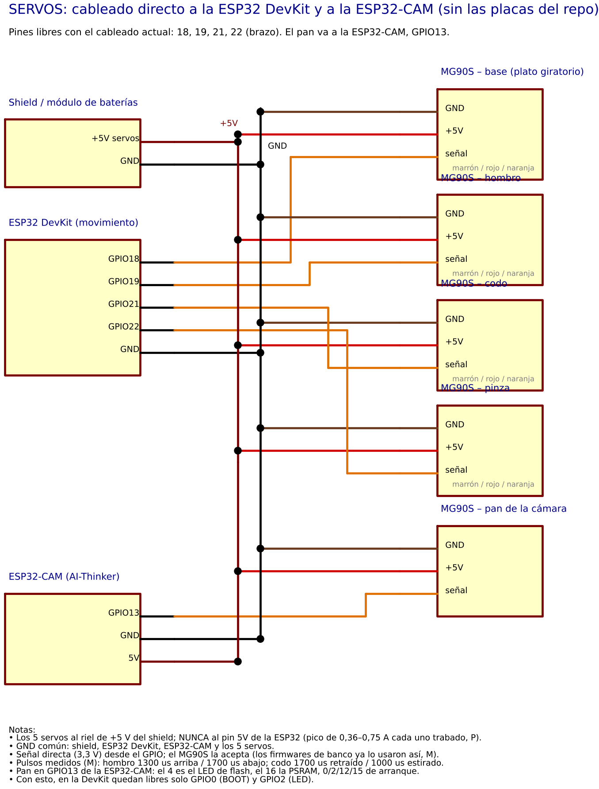

# Pruebas por componente (inalámbricas, por micro-ROS)

Un programa por componente, para probar el robot pieza por pieza **como el día de la competencia**: la ESP32 se conecta
por Wi-Fi al agente micro-ROS de la PC, y desde la PC se manda todo y se ve todo. No hace falta el monitor serie.

> Estados: **M** medido en el banco · **C** calculado · **P** propuesta sin probar.
> **Ninguno de estos programas se compiló todavía con ESP-IDF** (en la máquina donde se escribieron no se pudo instalar).
> Usan las mismas funciones de ESP-IDF 5.5 y de micro-ROS que `firmware/banco/robot_4ruedas/main.c`, que sí compiló y anduvo.
> Si alguno no compila, pasame el error (sin el log del Wi-Fi).

## 1. Mapa de pines

Circuito completo con este pinout (resistencias, capacitores, módulos): [img/circuito_completo_pinout_actual.png](img/circuito_completo_pinout_actual.png).

### ESP32 de movimiento (DevKit de 38 pines)

| Componente | Señal | GPIO | Estado |
|---|---|---|---|
| Rueda FL (delantera izq.) | IA / IB | 25 / 26 | ya cableado |
| Rueda FR (delantera der.) | IA / IB | 17 / 33 | ya cableado |
| Rueda RL (trasera izq.) | IA / IB | 27 / 16 | ya cableado |
| Rueda RR (trasera der.) | IA / IB | 23 / 32 | ya cableado |
| Encoders | FL / FR / RL / RR | 34 / 36 / 35 / 39 | ya cableado |
| Sonar frontal | TRIG / ECHO | 5 / 13 | ya cableado |
| Sonar derecho | TRIG / ECHO | 15 / 4 | ya cableado |
| Sonar izquierdo | TRIG / ECHO | 14 / 12 | ya cableado |
| **Servo base** (plato giratorio) | señal | **18** | nuevo |
| **Servo hombro** | señal | **19** | nuevo |
| **Servo codo** | señal | **21** | nuevo |
| **Servo pinza** | señal | **22** | nuevo |
| LED de la placa | — | 2 | estado del enlace |

Con esto quedan libres solo el **GPIO0** (botón BOOT) y el **GPIO2** (LED), los dos de arranque. Los pines 1 y 3 son del USB.
Los servos del brazo van en 18, 19, 21 y 22 porque son los únicos libres que no son de arranque, y son los mismos que ya
usaban los firmwares de banco del brazo (`firmware/banco/brazo/`).

### ESP32-CAM (AI-Thinker)

| Componente | Señal | GPIO |
|---|---|---|
| **Servo de giro de la cámara (pan)** | señal | **13** |
| LED rojo de la placa | — | 33 (activo en bajo) |

El 13 es de los pocos libres de la AI-Thinker: el 4 enciende el LED de flash, el 16 es de la PSRAM, el 0, 2, 12 y 15 son de
arranque y los demás los usa la cámara. El 13 y el 14 quedan libres mientras no se use la tarjeta SD.

## 2. Conexiones

### Servos (los 5)



```
Servo MG90S         Va a
  marrón  (GND)  -> GND del riel de servos (= GND de la ESP32 y del shield)
  rojo    (+5V)  -> +5 V del riel de servos del shield (NO el pin 5V de la ESP32)
  naranja (señal)-> GPIO de la tabla (directo, 3,3 V)
```

- El pan va al **GPIO13 de la ESP32-CAM**, alimentado del mismo riel de 5 V, con GND común.
- Los servos piden picos de 0,36–0,75 A cada uno trabados (P). Si la ESP32 se reinicia al mover el brazo, es el 5 V que cae.

### Sonares (ya montados)

- VCC a 5 V, GND común, TRIG directo al GPIO.
- ECHO a través de un divisor: **2,2 kΩ en serie y 3,3 kΩ a GND**, que deja 3,0 V en el pin. Con sensores HC-SR04P o
  RCWL-9610A alimentados a 3,3 V, el ECHO va directo.
- El **GPIO12 (ECHO izquierdo) tiene que estar en bajo al encender**, si no la ESP32 no arranca. El divisor (3,3 kΩ a GND)
  lo asegura; el firmware además le pone el pull-down interno.

### ESP32-CAM: cómo grabarla

- Con la placa ESP32-CAM-MB (la del USB), alcanza con enchufarla.
- Con un adaptador USB-serie (FTDI, a 5 V):

| FTDI | ESP32-CAM |
|---|---|
| 5V / GND | 5V / GND |
| TX | U0R (GPIO3) |
| RX | U0T (GPIO1) |
| — | GPIO0 a GND solo para grabar; después sacarlo y apretar RESET |

## 3. Preparación (una sola vez)

1. Tener andando lo de `docs/guias/micro-ros.md`: ESP-IDF 5.5, el componente `micro_ros_espidf_component` (rama `jazzy`)
   clonado en `~/caid/pruebas-banco/` y la imagen del agente (`docker pull docker.io/microros/micro-ros-agent:jazzy`).
2. En el ejemplo `int32_publisher`, `idf.py menuconfig` → `micro-ROS Settings`: `WLAN interface`, red y clave del Wi-Fi,
   **IP de la PC** como `micro-ROS Agent IP` y puerto `8888`. Guardar con la letra `S`. Es el mismo ajuste que ya usan para
   `robot_4ruedas`; si ya lo hicieron, no hay que tocarlo.
3. Si el ejemplo está en otra carpeta: `export MICROROS_EJEMPLO=/ruta/al/int32_publisher` antes de `compilar.sh`.

## 4. Las terminales

Siempre 3 terminales; la 1 y la 3 quedan abiertas durante todas las pruebas.

**Terminal 1 — agente** (normal, se deja corriendo):

```bash
docker run -it --rm --net=host docker.io/microros/micro-ros-agent:jazzy udp4 --port 8888
```

**Terminal 2 — grabar la prueba** (la terminal LIMPIA de ESP-IDF, sin ROS):

```bash
env -i HOME="$HOME" USER="$USER" TERM="$TERM" PATH=/usr/local/sbin:/usr/local/bin:/usr/sbin:/usr/bin:/sbin:/bin bash --noprofile --norc
. ~/esp/esp-idf-v5.5/export.sh
cd ~/caid/Competencia-Robotica-CAID/firmware/pruebas
./compilar.sh 00_enlace                 # o el numero/nombre de la prueba; puerto por defecto /dev/ttyUSB0
```

- Si el puerto es otro: `./compilar.sh 00_enlace /dev/ttyUSB1`.
- Para ver el monitor serie: `./compilar.sh 00_enlace /dev/ttyUSB0 monitor`. **El monitor muestra la clave del Wi-Fi: no
  pegar ese log en ningún lado.** Salir con `Ctrl+]`.
- Al grabar: si el 5 V del shield está conectado al pin 5V de la ESP32, **desconectarlo antes de enchufar el USB**. Mantener
  BOOT apretado cuando aparece `Connecting......` si no engancha solo.

**Terminal 3 — manejar desde la PC** (normal, con ROS):

```bash
source /opt/ros/jazzy/setup.bash
cd ~/caid/Competencia-Robotica-CAID
python3 tools/pruebas/prueba.py 00_enlace          # el mismo nombre que se grabó
```

- `python3 tools/pruebas/prueba.py` sin nada lista todas las pruebas.
- `?` muestra las teclas, `q` sale y deja todo quieto.
- Si la pantalla dice "la ESP32 tiene grabada la prueba X", la grabada es otra: grabar la correcta.
- Opcional, terminal 4: `ros2 topic echo /prueba/estado` (o `/prueba_cam/estado`) muestra los números crudos.

LED de la placa: **parpadea** mientras busca al agente; **apagado** = conectada.

## 5. Las pruebas, en orden

Recomendado: primero la 00, después cada componente solo, después los combinados.

### 00 — Enlace (`00_enlace`)

- **Qué hace:** no mueve nada. Mide la ida y vuelta de un mensaje PC → ESP32 → PC y la señal Wi-Fi. `l` prende el LED.
- **Qué mirar:** RSSI mejor que −70 dBm; ida y vuelta mediana de unos 50–150 ms y pocas por encima de 300 ms. El
  número incluye hasta 100 ms de espera hasta el próximo estado (C). En el banco, el ping a la ESP32 dio 15 ms de mediana
  con picos de 400 ms (M, `micro-ros.md`).
- **Antes:** nada. Es la que confirma red, IP del agente y Wi-Fi.

### 10, 11, 12 — Un sonar (`10_sonar_frontal`, `11_sonar_derecho`, `12_sonar_izquierdo`)

- **Qué hace:** mide cada 60 ms y muestra la distancia, la mediana de las últimas 5 y el % de mediciones perdidas.
- **Qué mirar:**
  - Una pared a 10, 20 y 50 cm (medida con cinta) tiene que dar lo mismo ±1 cm.
  - Sin nada adelante (más de 4 m): "---" y perdidas en aumento; está bien.
  - Si da siempre "---" con una pared cerca: ECHO, divisor o alimentación.
  - Si da siempre lo mismo moviendo la mano: TRIG.
- **Antes:** probar uno por vez; es como saber cuál de los tres no anda.

### 13 — Los 3 sonares (`13_sonares_3`)

- **Qué hace:** los 3, de a uno (como se van a usar). `m` cambia a los 3 a la vez, para ver si se interfieren.
- **Qué mirar:**
  - En secuencial, cada uno mide su pared.
  - En simultáneo, si aparecen distancias raras o más perdidas que en secuencial, se interfieren (cross-talk).
  - Probarlo dentro de un pasillo de 32 cm (con cajas o con el laberinto).

### 20–23 — Un encoder (`20_encoder_FL`, `21_encoder_FR`, `22_encoder_RL`, `23_encoder_RR`)

- **Qué hace:** los motores quedan en 0 y la rueda se gira **a mano**. Muestra los flancos, las vueltas y también los otros 3 encoders.
- **Qué mirar:**
  - **1 vuelta de rueda = 40 flancos** (M).
  - Si al girar esta rueda cuenta otro encoder, los cables están cruzados (la pantalla lo avisa).
  - Si no cuenta: VCC del FC-03 a 3,3 V, GND y D0 al GPIO correcto.

### 30–33 — Un motor (`30_motor_FL`, `31_motor_FR`, `32_motor_RL`, `33_motor_RR`)

- **Qué hace:** mueve solo esa rueda con su encoder. `w`/`s` sube o baja el duty de a 0,05; `1`..`9` lo fija en 0,1..0,9;
  `0` o Espacio para.
- **Qué mirar:**
  - **Con duty positivo, la rueda gira hacia ADELANTE.** Si gira al revés, la polaridad de esa rueda va a −1 en
    `comun/ruedas.h` (o dar vuelta los cables del motor).
  - Desde parado y sin empujón, arranca recién con duty 0,48–0,64 (M, delantera, en el aire); una vez girando se
    sostiene hasta 0,36 (delanteras), 0,40 (RL) o 0,50 (RR) (M). Por debajo zumba sin girar. Esta prueba no da empujón:
    para arrancar, subir con `w` hasta que gire.
  - Solo cuenta el encoder de esta rueda (si cuenta otro, la pantalla avisa).
  - A duty 1,0, unos 210–220 flancos/s en las delanteras (M); las traseras son otro motor y dan menos (M).
- **Antes:**
  - **Rueda en el aire** (robot sobre un soporte).
  - La FR no contaba flancos a duty 1,0 y se cortaba el enlace (M, 28/10): probarla primero a duty bajo.
  - Si la PC deja de mandar 600 ms, el motor frena solo.

### 34 — Las 4 ruedas (`34_ruedas_4`)

- **Qué hace:** `1`..`4` elige una rueda, `t` las 4, `w`/`s` sube o baja el duty de lo elegido, Espacio para todo.
  `v` hace la **verificación automática de cableado**: mueve FL, FR, RL y RR de a una (2,5 s cada una) y arma una tabla de qué
  encoder contó con cada rueda.
- **Qué mirar:**
  - En la verificación, solo la diagonal (cada rueda con su encoder); la pantalla dice qué está mal.
  - Mirar con los ojos que las 4 giren hacia adelante.
  - Con las 4 juntas a duty alto, si la ESP32 se reinicia, el elevador de 5 V no da (propuesta v0.2).
- **Antes:**
  - Robot en el aire para la verificación.
  - Para el piso y el PID, el programa de siempre es `firmware/banco/robot_4ruedas` con `tools/banco/robot_teclado.py`.

### 40–43 — Un servo del brazo (`40_servo_base`, `41_servo_hombro`, `42_servo_codo`, `43_servo_pinza`)

- **Qué hace:** arranca **sin pulsos** (el servo sin fuerza).
  - `g` lo activa en el pulso de reposo.
  - `a`/`d` mueven ±10 µs y `A`/`D` ±50 µs; `i` va a un valor.
  - `s` lo suelta. `m` anota el pulso actual con una nota en `~/caid/config/marcas_servos.csv`, para armar la tabla de
    pulso contra ángulo.
  - Velocidad 200 µs/s (unos 20°/s).
- **Pulsos conocidos (M):** hombro 1300 µs arriba / 1700 µs abajo; codo 1700 µs retraído / 1000 µs estirado; en la pinza,
  subir el pulso abre y bajarlo cierra; en la base, bajar el pulso va al lateral izquierdo.
- **Pulsos sin medir (P):** el reposo de la base y el de la pinza (el programa supone 1500 µs). La primera vez, activar con
  el servo libre (sin el brazo armado o con el brazo suelto) para que el salto no fuerce nada.
- **Límites de arranque:**

  | Servo | Rango (µs) |
  |---|---|
  | base | 1000–2000 |
  | hombro | 1300–1700 |
  | codo | 1000–1700 |
  | pinza | 1000–2000 |

  `x` los abre, como máximo hasta 500–2500. **No llevar ningún servo contra su tope**: si zumba quieto más de 2 s, `s`.
- **Antes:** los servos van al riel de 5 V, no al pin 5V de la ESP32. Si se pierde el enlace, el servo se queda donde está
  (no se suelta, para que el brazo no caiga).

### 44 — El brazo coordinado (`44_brazo_coordinado`)

- **Qué hace:** los 4 servos juntos.
  - `b h c p` eligen un servo para moverlo a mano (`a d A D`).
  - `0`..`9` va a una pose: los 4 llegan juntos, con arranque y frenado suaves, en 2 s por paso (`t` lo cambia).
  - `r` corre la secuencia completa y `n` la hace paso a paso.
  - Espacio detiene todo donde está.
- **Secuencia (la pedida):**

  | Paso | Pose | Qué hace |
  |---|---|---|
  | 1 | arriba | subir el hombro con el codo retraído |
  | 2 | lateral | girar la base al costado izquierdo |
  | 3 | abierta | abrir la pinza |
  | 4 | extendida | estirar el codo (bajando un poco el hombro) |
  | 5 | cerrada | cerrar la pinza |
  | 6 | retraída | retraer el codo |
  | 7 | levantada | subir el hombro |
  | 8 | atrás | girar la base hacia atrás con el cubo |
  | 9 | reposo con cubo | bajar y apoyar en el 2.º piso |

- **Las poses de base y pinza son propuestas (P)** y hay que ajustarlas:
  1. Llevar el brazo a mano con `b h c p` y `a d A D` hasta la posición buena.
  2. `k` guarda la posición actual como pose N. `e` cambia un valor suelto y `l` lista todas.
  3. Se guardan en `~/caid/config/brazo_poses.json` y se mandan solas cada vez que la ESP32 se conecta (la ESP32 no las
     guarda al apagarse).
- **Antes:**
  - Probar cada servo solo (40–43) antes de este.
  - Activar (`g`) **con el brazo en el reposo** (atrás, abajo y retraído), porque los 4 saltan a esa pose.
  - Con el brazo armado, el hombro no levantaba solo (M, 27–29/10): si zumba sin subir, Espacio y `s`.

### 50 — Servo de la cámara (`50_servo_pan_cam`) — **se graba en la ESP32-CAM**

- **Qué hace:** igual que un servo solo, más `w` (barrido continuo entre los límites). La cámara no se enciende en esta
  prueba. Usa otros tópicos (`/prueba_cam/...`) y puede estar conectada a la vez que la ESP32 de movimiento.
- **Cómo:**
  - Terminal 2: grabar con el FTDI o la placa MB, `./compilar.sh 50_servo_pan_cam /dev/ttyUSB0`.
  - Si se usa FTDI: sacar el puente GPIO0–GND y apretar RESET.
  - Terminal 3: `python3 tools/pruebas/prueba.py servo_pan_cam`.
- **Qué mirar:** de 1000 a 2000 µs tiene que girar unos ±45° (P); con `x` se abre el rango si hace falta ±90°.
  El LED rojo de la placa parpadea mientras busca al agente.
- **Después:** volver a grabar el firmware de la cámara (`firmware/esp32_cam`) para tener video. El pan todavía no está
  en ese firmware (pendiente: pasarlo, con la misma configuración de PWM de esta prueba).

## 6. Si algo no anda

| Síntoma | Qué mirar |
|---|---|
| La PC dice "Esperando a la ESP32" y el LED parpadea | Agente corriendo (terminal 1); IP de la PC en menuconfig; misma red Wi-Fi de 2,4 GHz |
| "La ESP32 tiene grabada la prueba X" | Grabar la prueba que se quiere probar |
| La ESP32 se reinicia al mover motores o servos | Caída del 5 V: probar con duty más bajo, de a un servo, o con otra fuente |
| `bind error ... 8888` en el agente | Ya hay otro agente corriendo: `docker ps` y `docker stop <ID>` |
| No compila | Pasar el mensaje de error (no el log del Wi-Fi) |

## 7. Archivos

| Archivo | Para qué |
|---|---|
| `00_enlace.c` … `50_servo_pan_cam.c` | Una prueba cada uno (`PRUEBA_ID` = el número del nombre) |
| `comun/prueba_uros.h` | Conexión micro-ROS (con reconexión), tópicos `/prueba/cmd` y `/prueba/estado`, motores en 0 al arrancar |
| `comun/sonar.h`, `comun/ruedas.h`, `comun/servos.h` | Manejo de cada tipo de componente (pines, PWM, encoders) |
| `compilar.sh` | Copia la prueba al ejemplo de micro-ROS, compila y graba |
| `../../tools/pruebas/prueba.py` | La herramienta de la PC (una sola para todas) |

Protocolo: la PC manda `[id de la prueba, orden, argumentos...]`; la ESP32 publica `[id, contador, datos...]` 10 veces por
segundo. Las órdenes y los datos de cada prueba están en el comentario de arriba de su `.c`.
